# ローカル Web 実画面監査と lock 修復の検証

2026-11-03。親計画: [Android 再始動監査](../goals/android-restart-audit-2026-11.md)。製品変更の実績ではなく、復旧した検証環境での現状評価。

## 対象と証拠

- 製品ソースは develop `a93721414c12643280e65359b101b7fa1e750c85`。検証 checkout は lockfile 8行削除のみの `03cbb89b00051c052058ff07e85bc800a47ab48f` / [PR #466](https://github.com/s977043/digital-omikuji/pull/466)。UI/SDK設定/依存versionは未変更。
- production Web export を `http://localhost:4173` で配信。Chromium、ja-JP、390×844 CSS px。追加で320×568、en-US。スマホ幅のブラウザー検証であり Android 実機ではない。
- 画像はこの調査中に取得し、保存後に目視確認したもの。実在利用者データは使っていない。共有はローカルPNGダウンロードのみ、外部送信なし。
- 公開URLの403を迂回していない。公開サービスの配信版・通信・実機のセンサー/音/振動/共有・TalkBackは未検証。
- product-design audit の画面証拠・手順・所見の形式と repository browser/testing 手順を利用。cloud critical-overrides リソース取得不可のため Plugin 全手順完了とはしない。

## Step 1: 初回理解 — 開始可能、レイアウトと案内に改善余地

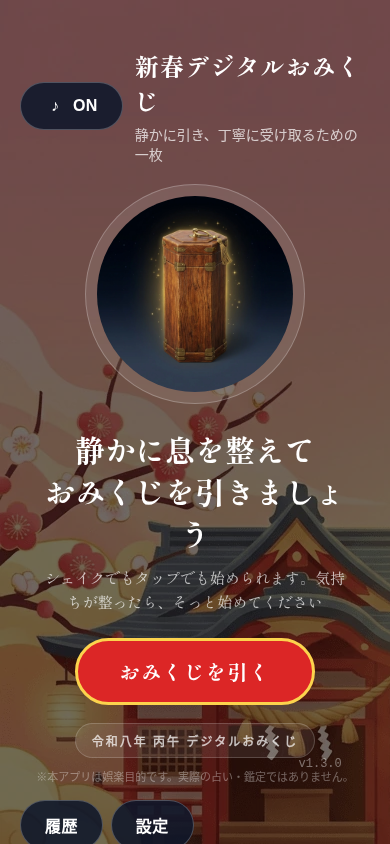

主CTAは識別しやすく、tapで開始できた。一方、390pxでタイトル最後の「じ」だけが改行し、本文の最後も一文字行になる。下部「履歴」「設定」は初回表示で画面下端にかかる。引く前の画面に「1日1回」が見当たらず、結果後に制限を知る構成。
Webではシェイク無効なのに「シェイクでもタップでも」と案内。nativeでの挙動は別途確認する。

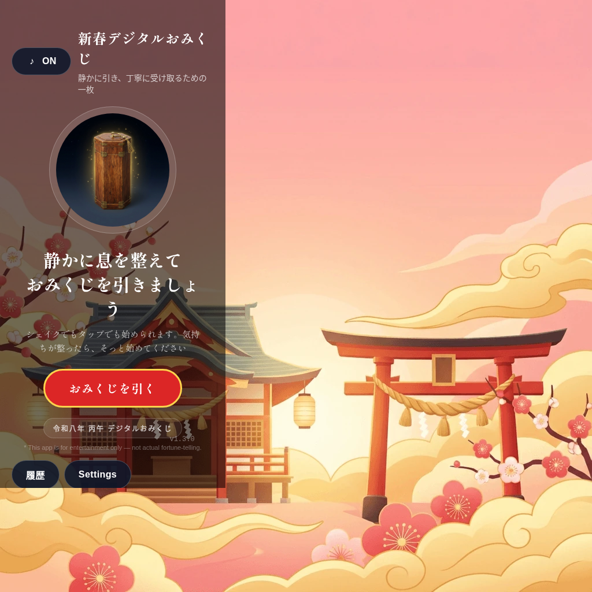

390×844 viewport に対して document scrollWidth/scrollHeight は **1024×1024**。背景に1024px幅の要素があり、横に大きく余る。単なる画像の切抜き問題ではなくDOM寸法でも確認。修正案は `ExperienceScreenTemplate` の背景サイズとoverflowの制約を見直し、320/390/desktopでscrollWidthがviewportを超えない回帰確認を追加すること。まだ実装していない。

en-USでは見出し・案内は日本語、設定/免責/結果は英語になった。日本語初版に限定するか、全導線を翻訳するかを掲載言語と合わせて決める。

## Step 2: 抽選 — tapと進行は成功、実機の動作は未検証

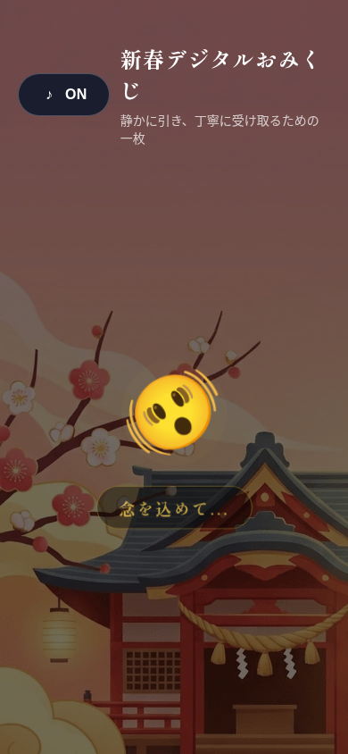

tap→「念を込めて...」→結果へ進行。progressbarと結果dialogの名前をDOMで確認。設定の動き抑制を保存してreload後、翌日fixtureでdouble-clickしても履歴は1件だけ増えた（1→2）。動き抑制時はclickから結果表示まで約2.8秒の単発観測。性能改善率・実機の快適性を示す測定ではない。
センサーとの同時発火、draw中のAndroid Back/背景復帰、低性能端末、OSのmotion設定は未検証。

## Step 3: 結果・保存 — 表示と再閲覧は成功、保存完了の意味が曖昧

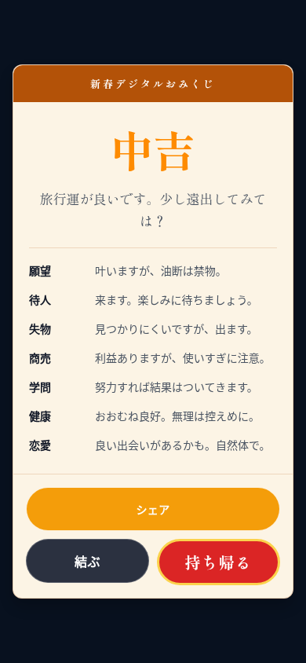

運勢・メッセージ・項目別本文の階層が明確。結果表示時点でlocalStorageに履歴があり、「持ち帰る」後は「結果をもう一度見る」へ戻る。「持ち帰る」が端末画像保存なのか履歴保存なのかは画面だけでは不明瞭。実際の保存時点と合わせ、「履歴に保存済み」等の説明と行動名を検討する。
result dialog のTab移動は「結ぶ→持ち帰る→シェア→結ぶ…」と内部で循環した。完全なスクリーンリーダー適合やcontrast合格は判定していない。運勢の明るい橙色と淡色背景、初回画面の細い補助文はコントラスト測定候補。

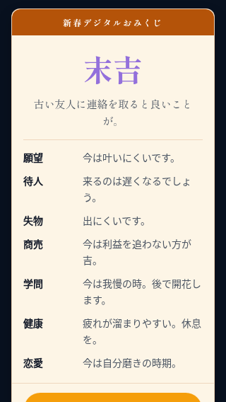

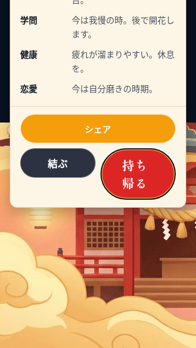

320×568では操作部が初期viewport外にあるが、scrollIntoView後に到達でき、操作も成功。ただし「持ち帰る」が2行へ折れ、画面全体の背景が下に露出する。背景overflowとoverlayのスクロール領域を一緒に検証する。文字拡大のテストを行ったとは扱わない。

## Step 4: 共有 — Webの代替動作は成功、画像の構成に改善余地

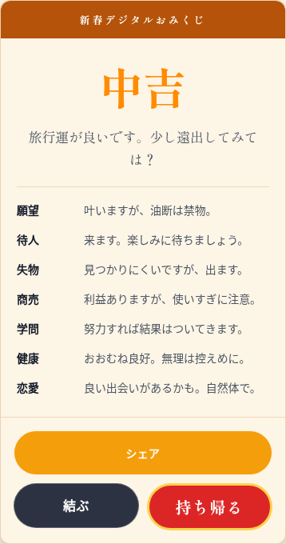

このChromiumではnavigator.share/canShareがなく、画像ダウンロードにfallbackし `omikuji.png` を取得できた。画像には「シェア」「結ぶ」「持ち帰る」も含まれる。結果を共有する目的では不要な操作部なので、capture対象を表示本文・ブランド部分へ分離する案を推奨。
native share sheet、Androidで画像添付が届くか、共有キャンセル、画像生成失敗時の案内は未検証。Androidの画像payload不足というコード所見は、このWeb成功では解消しない。

## Step 5: 履歴・設定・文書 — 基本動線は成功、policyへの入口を確認できず

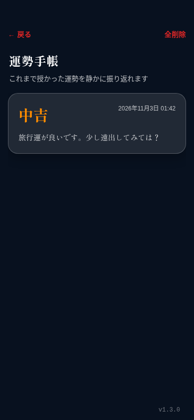

履歴1件と時刻・本文を確認。「全削除」の確認をキャンセルしても履歴は残った。削除確定・保存失敗・破損storageはこのブラウザー監査では試していない。

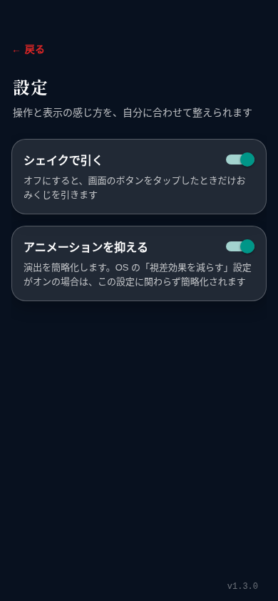

switchには名前とchecked状態があり、設定変更はreload後にも保持された。設定・初回画面の操作要素にpolicyへのリンクを見つけられず、実装検索でも当該画面からの遷移を確認できなかった。設定内にpolicy/問い合わせ導線を置く案を検討する。

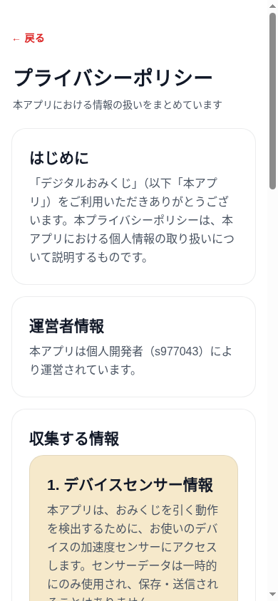

policyの直リンク表示と戻る→homeは成功。紙面は本文が読みやすい一方、DOMでは各sectionがh1相当となっている。見出し階層は改善候補。Sentryと非収集説明の不一致は依然として公開前ゲート。

## Step 6: 再訪 — 同日は維持、日付変更には再読込が必要

同日reloadで既存結果の再閲覧になり、履歴数は1件のまま。

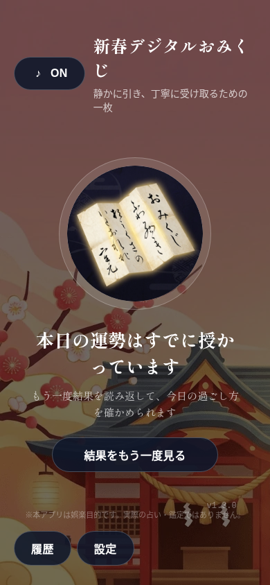

Playwright clockで日付を2026-11-04へ変更した直後も「本日の運勢はすでに授かっています」のまま。reloadすると抽選可能へ切り替わった。実際に24時間待った試験ではなく、日付変更のシミュレーション。日付境界・foreground復帰で判定を更新する案を提案する。offline起動・timezone移動・アプリ再インストールは未検証。

## 再始動の次の小さな変更

1. lock修復をレビュー可能な最小PRとして維持。SDK不整合は別PRで、#458等の依存PRと重複しない範囲を決める。
2. 公開前の必須項目としてSDK整合/Hermes既知問題、実送信とpolicy一致、Android画像共有を再現・解消する。
3. UIは初回の「1日1回」、背景overflow、policy導線、保存行動名、共有画像のcapture範囲を小分けに検証する。全面刷新を前提にしない。
4. 日本語初版の範囲と手元Android端末を確認し、実機でセンサー/触覚/音/Back/TalkBack/大きい文字/再訪を実施する。

## 5観点の検証と残ゲート

| 観点 | 結果 |
| --- | --- |
| 要件 | Android-first、準備修復と製品変更を分離。修復PRはlock8行削除のみ |
| 境界 | optional/non-optional重複を通常依存側へ統合。double-click、同日reload、翌日clock、削除cancel、狭い画面、dialog Tab循環を実測 |
| 設計安全 | package.json/importers/overrides/依存version不変。独立Codexレビューで阻害指摘なし。製品画面所見は未修正 |
| 回帰統合 | frozen install、tsc、ESLint、45 suites/311 tests、Web export6routes、Android JS export、既存Web E2E 5件（system Chromium/ja-JP）成功 |
| 最終条件 | #466のCIでもsetup/type/test/lint成功、Web E2Eは15件成功（[run](https://github.com/s977043/digital-omikuji/actions/runs/41561569081)）。Repo Guardsはexpo-doctor失敗。独立レビューとgreen CIは区別。署名/AAB/実機/ストア操作未実施、保護設定未確認のままmergeしない |

ローカルNode24.19.0 / pnpm9.15.2、CIはrepository既定Node22。ローカルdoctorは18/22（API通信失敗を含む）、[CI doctor](https://github.com/s977043/digital-omikuji/actions/runs/41561569192)は19/22で、dom-webview不整合、Hermes既知問題、SDK想定版不一致が残った。Android JS exportは署名付きAABの代替ではない。
Web exportは成果物を生成した後、終了時に `Something prevented Expo from exiting, forcefully exiting now` と出力した。生成物の配信と操作/E2Eは成功したが、終了時警告の原因は未調査。
[Expo公式のSDK57説明](https://expo.dev/changelog/sdk-57#known-regressions)でもSDK56由来のHermesメモリ問題と修正を確認した。次の依存更新はSDK対応表に揃えて判断し、この修復PRで一括更新やdoctor抑制は行わない。

追補文書にも独立Codexレビューを実施。6画像の所見、全相対リンク、ローカル検証ログ、Web/実機と観測/提案の区別を確認し、阻害指摘なし。旧状態の見出しとexport終了警告の記載について改善提案を受け、本記録へ反映した。

記事へ使える今回の実績は「lock8行修復で検証環境を復旧し、実画面の所見を得た」まで。UI改善・性能改善・公開成功・Plugin有効性の実績とはしない。OSS製品側変更・新規Issue投稿は行っていない。
