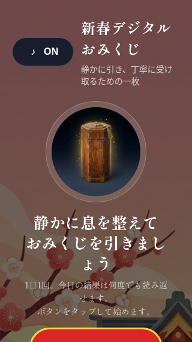
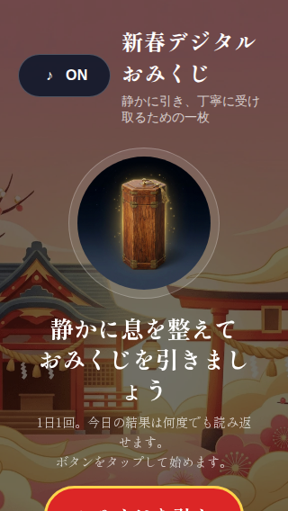
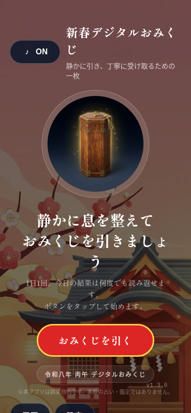
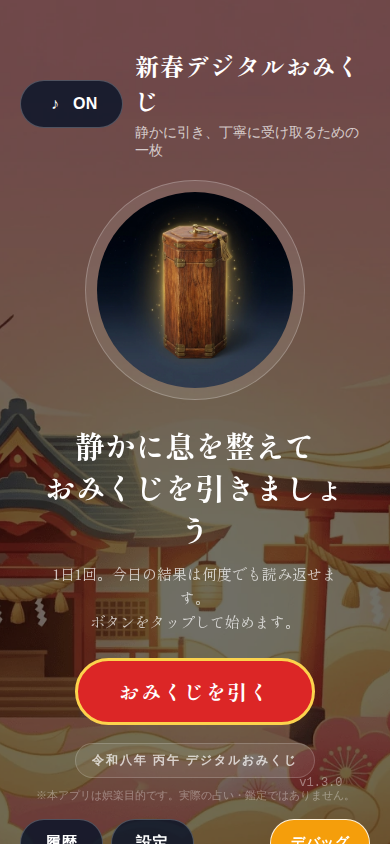

# 小画面の横幅改善（検証中）

2026-11-03。基準: develop `a937214`、#466 `03cbb89`、#467 `97192bd`。この作業は #467 を土台とし、#466 と #467 のマージに依存する。

## 問題と仮説

Web監査の Web 監査では390px viewport に対し document 幅1024pxを観測。320×568ではCTAを表示するため縦スクロールが必要だった。縦方向のスクロールはコンテンツへの到達手段であり、不要な横方向のスクロールと区別する。

背景画像は1024×1024px。React Native Web の Image は画像元の寸法をスタイルに取り込み、ImageBackground の内部画像に明示サイズがない。これが横幅の原因という仮説に対し、Web画像の幅と高さを親の100%に制約する。native のスタイルは変更しない。ブラウザーのDOM検証が必要であり、原因確定ではない。

## 実行・レビュー

- 型検査、ESLint: 成功。Jest: 45 suites、316 tests 成功。
- 修正前の Web export: 6 routes 成功。ローカル Playwright はブラウザー起動時の `socket() failed: Operation not permitted` で停止し、画面の計測・前後比較は未実施。2件のテスト失敗はアサーションの結果ではない。
- [Web E2E CI](https://github.com/s977043/digital-omikuji/actions/runs/41657201182)（アプリ HEAD `d085f487`）は3ブラウザー合計24件成功。320×568 / 390×844の抽選前・結果表示・再訪で document.scrollWidth が viewport 幅以下、抽選・結果の再閲覧と保存データ一致を確認。結果ダイアログの aria-modal も確認。画像を含む[レポート](https://github.com/s977043/digital-omikuji/actions/runs/41657201182/artifacts/13239854843)は7日間保持。
- [通常CI](https://github.com/s977043/digital-omikuji/actions/runs/41657201099)では型・テスト・ESLint成功、Repo Guardsはexpo-doctorで失敗。Production JS bundleは同ジョブでskip。
- レビュー: Webのみの変更でnative表示への直接変更を避け、縦スクロールを隠す `overflow: hidden` は使用していない。320pxではCTA下部への到達にスクロールが必要だが、CIでスクロール後のクリックと結果の「持ち帰る」操作が成功。フォーカス循環・実機のスクロールは未検証。背景の切り取られ方が変化するため、目視でのデザイン承認が必要。
- #467 の390px前後画像と以前の監査は [初回体験の記録](2026-11-first-draw.md) および [PR #465](https://github.com/s977043/digital-omikuji/pull/465) を参照。今回の修正の前後比較ではない。

## 実画面比較

同じ初回案内 #467 の変更前画像と、本PRのCI上のDesktop Chromium・ja-JPの修正後画像。取得環境が異なるためピクセル単位の厳密な比較ではない。320pxは修正後もCTA下部が初期画面外。背景の構図に変化がある。

| 幅 | 修正前 (#467) | 修正後 (CI) |
| --- | --- | --- |
| 320×568 |  |  |
| 390×844 |  |  |

## 残ゲート

画像に見える背景構図の変化を確認し、キーボードのフォーカス循環を再レビューする。画像元のサイズが原因という仮説は、修正後の横幅テスト成功と整合するが、修正前DOMの寄与要素はこの環境では未測定。Android実機・TalkBack・大きい文字は未検証。実ユーザーのフィードバックも未取得。Repo GuardsのExpo SDK不整合は別件として維持し、抑制しない。マージ・ストア公開前に明示承認が必要。
